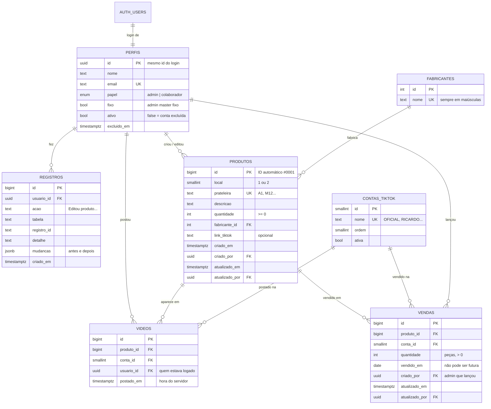

# Banco de dados

Banco PostgreSQL no **Supabase**. O esquema completo está em
[`supabase/migrations/20261104000000_esquema_inicial.sql`](../supabase/migrations/20261104000000_esquema_inicial.sql)
e [`supabase/migrations/20261105000000_vendas.sql`](../supabase/migrations/20261105000000_vendas.sql)
(vendas), e a carga inicial (contas do TikTok, fabricantes e os 239 produtos da planilha) em
[`supabase/seed.sql`](../supabase/seed.sql).

## Diagrama

Versão em imagem para compartilhar: [diagrama-banco.png](diagrama-banco.png).

## Tabelas

| Tabela | Para que serve | Tela do sistema |
|---|---|---|
| `perfis` | Uma linha por pessoa da equipe, ligada ao login do Supabase | Login, Admin → Equipe |
| `contas_tiktok` | As contas onde os vídeos são postados | Filtro de conta, Registrar vídeo |
| `fabricantes` | Lista única de fabricantes, para não repetir o mesmo com outro nome | Adicionar/editar produto, filtro |
| `produtos` | O estoque, com as colunas da planilha | Produtos, Adicionar, Editar |
| `videos` | Cada vídeo postado: qual produto, qual conta, quem e quando | Vídeos, Análise, Admin |
| `vendas` | Peças vendidas por produto, conta do TikTok e dia, lançadas à mão pelo admin (o TikTok não exporta vendas por vídeo) | Vendas |
| `registros` | Histórico automático de tudo o que foi alterado | Admin → Registros, histórico do produto |

## Views (consultas prontas para as telas)

| View | O que entrega | Usada em |
|---|---|---|
| `v_produtos_resumo` | Cada produto com fabricante, total de vídeos, vídeos em 30 dias, último vídeo e dias sem vídeo | Produtos, Análise (mais vídeos, há mais tempo sem vídeo, nunca tiveram vídeo) |
| `v_videos_semana` | Vídeos por conta, mês e semana (01 a 03, 04 a 10...), no horário de Brasília | Análise → Vídeos por conta e semana |
| `v_videos_por_pessoa` | Vídeos de cada pessoa em 7 dias, 30 dias e no total | Admin → Vídeos por pessoa |
| `v_vendas_semana` | Peças vendidas por produto, conta, mês e semana | Vendas (gráficos e filtros) |

O filtro por conta do TikTok nessas telas é feito consultando `videos` com `conta_id`.

## Regras garantidas pelo banco

Essas regras valem mesmo que alguém tente burlar o site, porque ficam no próprio banco
(segurança por linha, ou RLS, e gatilhos).

| Regra | Como |
|---|---|
| Sem login, ninguém vê nada | Nenhuma permissão para o papel `anon` |
| Conta excluída perde o acesso | Todas as regras exigem `ativo = true` |
| Data e hora do vídeo são as do servidor | Gatilho `carimbar_video` ignora o que vier do celular |
| O vídeo fica em nome de quem está logado | Mesmo gatilho |
| Ricardo e Márcio não perdem o cargo nem são excluídos | Gatilho `proteger_perfil` + campo `fixo` |
| Ninguém muda o próprio cargo nem exclui a própria conta | Gatilho `proteger_perfil` |
| Só admin master muda cargos, exclui contas e vê os registros | RLS + `eh_admin()` |
| Toda a equipe vê, adiciona e edita produtos; só admin exclui | RLS |
| Vendas: só admin master vê, lança, edita e exclui | RLS |
| Venda tem pelo menos 1 peça e não pode ter data no futuro | Validação no banco |
| Produto com vídeo ou venda não pode ser apagado | Chave estrangeira `on delete restrict` |
| Duas peças não ocupam a mesma prateleira | `prateleira` única |
| Nº de prateleira no padrão da planilha (A1, M12) | Validação no banco |
| Toda alteração vai para o histórico, com antes e depois | Gatilho `registrar_alteracao` |
| "Excluir conta" não apaga a pessoa | O histórico dela continua; `excluido_em` guarda a data |

## Projeto no Supabase

O banco já está criado no Supabase: projeto **gerenciador-estoque-videos**, região São Paulo
(`sa-east-1`), com as três migrações aplicadas e os 239 produtos carregados. O verificador de
segurança do Supabase não aponta nenhum problema.

As funções internas (permissões e gatilhos) ficam no schema `privado`, que não é exposto pela
API; só as tabelas e views do schema `public` são acessíveis, sempre filtradas pelas regras de RLS.

## Como montar no Supabase

1. Crie um projeto em supabase.com (região **São Paulo**, `sa-east-1`).
2. Abra **SQL Editor** e rode, nesta ordem, os arquivos da pasta `supabase/migrations/`:
   `20261104000000_esquema_inicial.sql`, `20261105000000_vendas.sql` e
   `20261105010000_ajustes_seguranca.sql`.
3. No mesmo lugar, cole e rode `supabase/seed.sql` (contas, fabricantes e os 239 produtos).
4. Em **Authentication → Providers**, deixe o login por e-mail e senha ativado.
5. Peça para o Ricardo e o Márcio criarem a conta pela tela de cadastro do sistema.
6. Abra `supabase/definir_admins_fixos.sql`, troque os e-mails pelos reais e rode no SQL Editor.

Se usar a Supabase CLI, os passos 2 e 3 viram `supabase db push` e o `seed.sql` é carregado
automaticamente no ambiente local.

## Testes

`bash tools/testar_banco.sh` sobe um PostgreSQL temporário, aplica o esquema e a carga inicial e
testa 44 regras como colaboradora, admin fixo, outro admin, conta excluída e visitante sem login.
Precisa do PostgreSQL instalado na máquina.

## Pontos para decidir com o cliente

- **Quem pode se cadastrar.** Do jeito que está, qualquer pessoa com o link do site consegue
  criar conta e já entra como colaborador, vendo e editando o estoque. Duas opções:
  (a) desligar o cadastro público no Supabase e o admin convida cada pessoa por e-mail, ou
  (b) toda conta nova nasce "pendente" até um admin aprovar.
- **Conta excluída ainda consegue fazer login**, mas não vê nem altera nada. Para bloquear o
  login de vez, é preciso uma pequena função no servidor (Edge Function) chamada pelo botão Excluir.
- **O ID automático pode pular números.** Se um cadastro falhar no meio (por exemplo, prateleira
  repetida), aquele número não é reaproveitado. É o comportamento normal do PostgreSQL.
- **Backup.** O plano gratuito do Supabase não faz backup automático. Ver o README.
